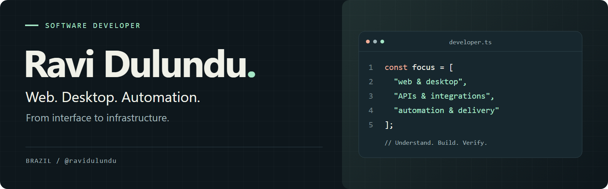

<picture>
  <source media="(prefers-color-scheme: light)" srcset="./assets/github-header-light.svg" />
  <source media="(prefers-color-scheme: dark)" srcset="./assets/github-header.svg" />
  
</picture>

<h1 align="center">Software developer. Practical problem solver.</h1>

  I connect interfaces, application logic, and infrastructure. 
  Building for the web and desktop, with a focus on maintainability, usability, and reliable delivery.

  
  
  
  

## Engineering toolkit

<table>
  <tr>
    <td width="50%" valign="top">
      <h3>01 / Web interfaces</h3>
      
      
<strong>TypeScript · React · Next.js · Tailwind CSS</strong>

      
Responsive interfaces, reusable components, accessible interactions, and frontend performance.

    </td>
    <td width="50%" valign="top">
      <h3>02 / Backend &amp; data</h3>
      
      
<strong>Node.js · PHP · PostgreSQL · Python</strong>

      
API integrations, application logic, relational data, and scripts that connect systems.

    </td>
  </tr>
  <tr>
    <td width="50%" valign="top">
      <h3>03 / Desktop applications</h3>
      
      
<strong>C# · .NET · WPF · Electron</strong>

      
Windows applications, desktop interfaces, and integrations between native and web technologies.

    </td>
    <td width="50%" valign="top">
      <h3>04 / Automation &amp; delivery</h3>
      
      
<strong>Linux · Docker · Bash · GitHub Actions</strong>

      
Repeatable environments, automated workflows, and a practical path from development to deployment.

    </td>
  </tr>
</table>

### Also in my toolkit

**WordPress development** — custom themes, content-driven websites, WP-CLI, and performance tuning. 
**Developer experience** — Git, VS Code, Dev Containers, and AI-assisted development with human review and verification.

## How I approach engineering

  <code>Understand</code> → <code>Design</code> → <code>Build</code> → <code>Verify</code> → <code>Refine</code>

Readable code, focused changes, useful documentation, and checks that match the risk. I care about how software behaves in use, as well as how easily the next developer can work on it.

## Let's connect

Based in **Brazil**. Through **[DulunduzTec](https://dulunduztec.com.br)**, I work on websites, WordPress, and automation for small businesses.

  
  

**Direct contact:** [ravidulundu@gmail.com](mailto:ravidulundu@gmail.com) · [LinkedIn](https://www.linkedin.com/in/ravidulundu/) · [X / @ravidulundu](https://x.com/ravidulundu) · [dulunduztec.com.br](https://dulunduztec.com.br)
